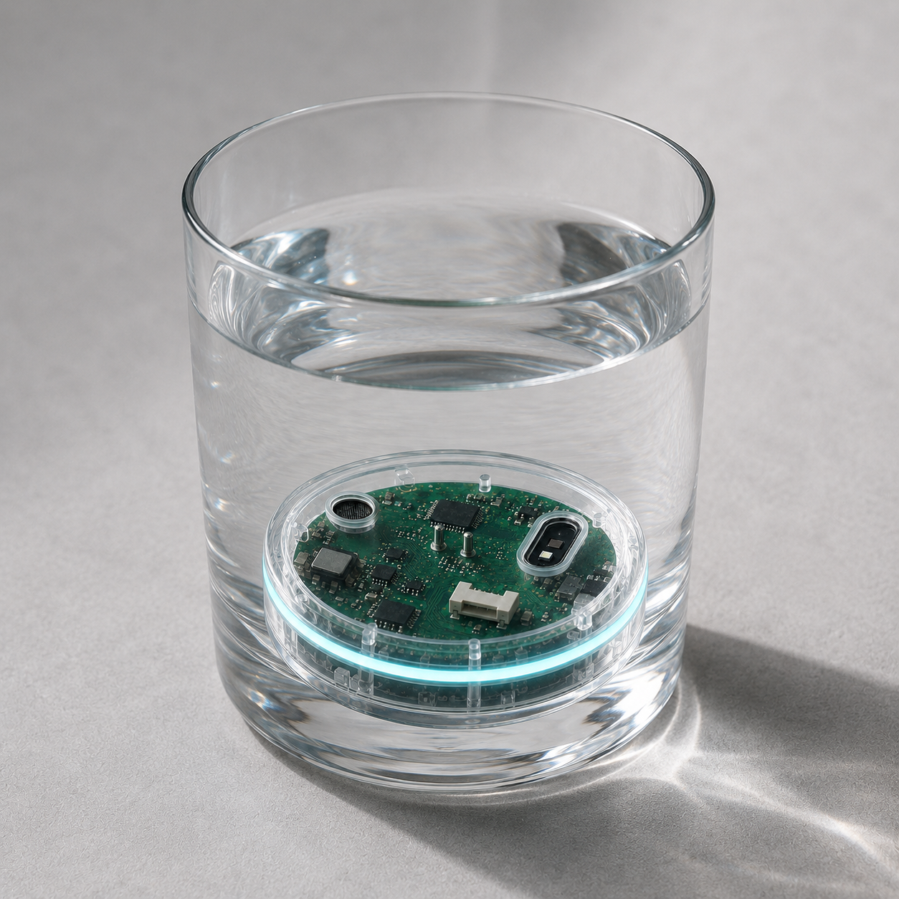
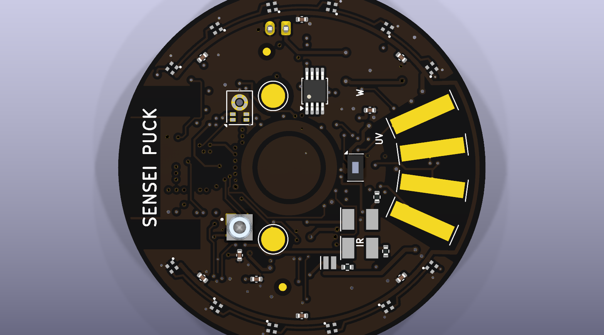
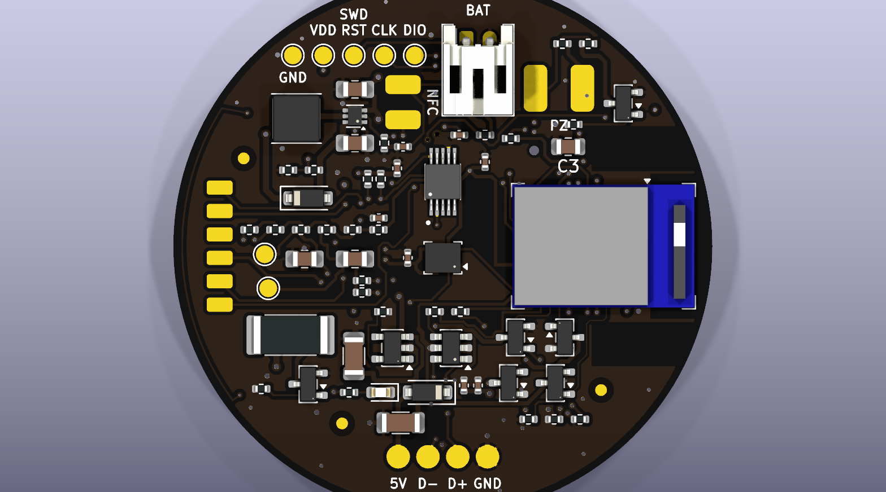

# Sensei Puck

**Archived 2026-10-24. Never built.** This is the record of a college
proof-of-concept that got as far as a finished schematic, a mostly routed
4-layer PCB and a bring-up firmware variant, then stopped before the first
board order. It is kept public as a design record, not as a kit to build.

<p align="center">
  
</p>

## What it was supposed to be

A Ø46 mm disc you drop into a glass or plastic jug. It sits on the bottom,
fully submerged, and logs what happens to the water: conductivity, temperature,
pressure (fill level and movement), a small spectral sensor with white / IR / UV
illumination, a capacitive wetness pair and a microphone. An nRF52840 module
talks BLE to a phone, radiating down through the container base from a dry air
cavity. Clear epoxy dip for waterproofing, magnetic pads for charging, OTA DFU
as the only reflash path after the dip. Raw counts plus acquisition settings
are stored; calibration happens downstream.

It was never meant to assess whether water is safe to drink. The honest scope
was "has this water changed since I last looked, and roughly how".

## What exists

| Part | State |
|---|---|
| `hardware/sensei-puck/` | KiCad 10 project. Schematic complete, ERC clean. Board placed on both faces (139 footprints, 4 layers). Last check: 1 clearance error, 25 connections still unrouted around the module. |
| `hardware/board-spec.md` | Pin contract, power rules, sensor notes, release requirements. |
| `firmware/` | PlatformIO + Adafruit nRF52 core. Custom `mdbt50q_puck` board and variant, safe-start `initVariant()`, REGOUT0 guard, a commissioning idle image and XIAO bench sketches. All targets compile. Nothing was ever flashed to a carrier. |
| `docs/images/` | Concept render, app mock, board renders. |

<p align="center">
  
  
</p>

Key parts: Raytac MDBT50Q-1MV2 (nRF52840), MCP73832 charger, TPS61023 5 V
boost for a 12-LED ring, FDC1004 capacitance, MS5837 pressure, AS7341 spectral,
LSM6DSO IMU, IM69D130 PDM mic, DS18B20U+ temperature, gold ENIG electrodes for
a 4-wire AC conductivity cell driven straight from GPIO with two-resistor
auto-ranging.

## Why it stopped

None of these alone killed it. Together they did.

- **A sealed puck is unforgiving.** Epoxy dip means no repair and no SWD after
  sealing, so the custom bootloader and the OTA path had to be proven perfect
  before the first dip. On a ~$300 budget with two PCB spins, one mistake in
  the pin map or the charger ends the project.
- **Radio through water was an unverified bet.** 2.4 GHz does not go through
  water. The plan relied on an air cavity under the board and the container
  base being thin glass or plastic, with store-and-forward and a tilt-triggered
  sync to cover the gaps. Plausible on paper, never measured, and it rules out
  metal bottles and thick ceramics outright.
- **The layout never closed.** The 0.4 mm pad pitch on the module, the no-via
  zone under the capacitive electrodes and the antenna keep-out box the module
  in on a 46 mm disc. Five autorouting strategies, two pin-swap passes and a
  0.1 mm local rule area got it from 130 opens to 25. The rest needed a
  placement redesign or a third attempt.
- **Every number needs a reference.** Conductivity and temperature readings
  only mean something against KCl standards or a lab meter. That is a bench
  campaign the project did not have time or access for.
- **The market check.** Products like WaterH (sensor in its own bottle) and the
  pool floats already ship the idea where it works, by owning the container.
  A drop-in puck for any container is the hard version, and the gap in the
  market is smaller than it looked.

## What I'd keep from it

The symmetric sensor face with the electrodes as the visual, the
GPIO-driven AC conductivity cell with switched bias, the "store raw counts and
settings" rule, and the habit of writing down every decision with a date and a
reason. The full decision log, work log, research notes and the earlier v1
board are in the git history before the archive commit.

## Running the firmware

```sh
cd firmware
pio run -e mdbt50q_puck -e puck
```

`mdbt50q_puck` is the carrier target. `puck` and `bench_*` run on a Seeed XIAO
nRF52840 Sense, which was the bench mule. See `firmware/README.md`.
